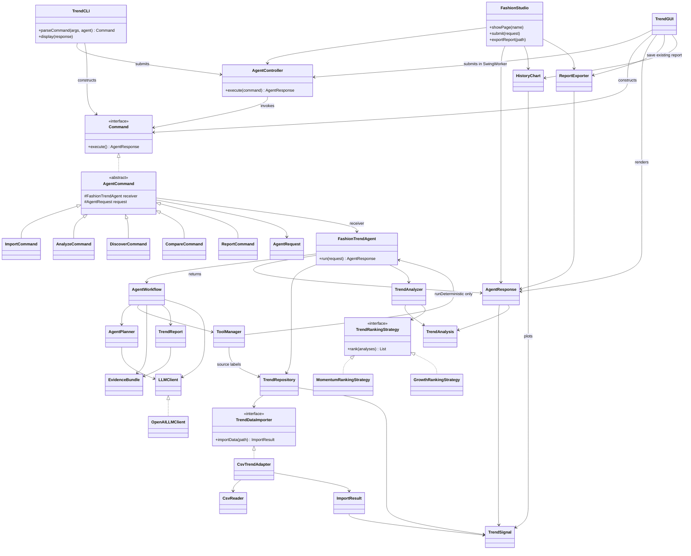
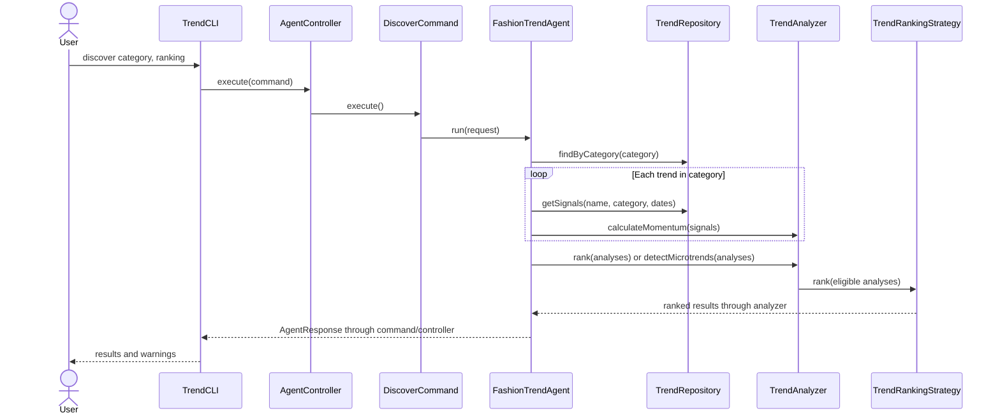
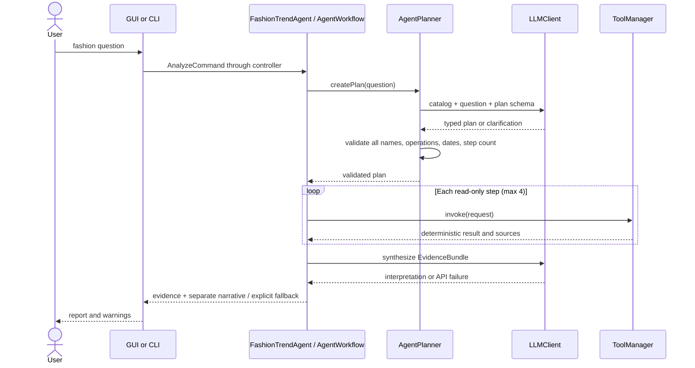

# Implemented architecture

This diagram describes the implemented GUI/CLI and LLM integration. Live Ask/Report API
smoke tests passed; automated API checks use a local fake server. A shared response carries data and diagnostics so each
interface can choose its own rendering without repeating application workflows.

Example sequence after CSV import (F06/F07):

Expected I/O and request errors are converted by the controller into unsuccessful
responses. Sparse data is explicit rather than fabricated: rankings exclude it
with warnings, and comparisons retain whatever observations can be analyzed.

Natural-language question sequence (F01):

For a known-trend report (F10), the agent builds history, analysis and category
retrieval steps directly; it does not need a model planning call. Failed synthesis
leaves the calculated report available. Clarifications and invalid plans do not
execute tools. API text never mutates repository data or numerical metrics.

Result navigation uses the table's view-to-model row mapping before constructing
existing analysis/history commands. ReportExporter writes the current immutable
AgentResponse report and warnings as UTF-8 using CREATE_NEW; it has no LLMClient
reference. The GUI runs export in a background worker and retains the report on a
save failure. Export is an F10 enhancement, not a sixth pattern.
