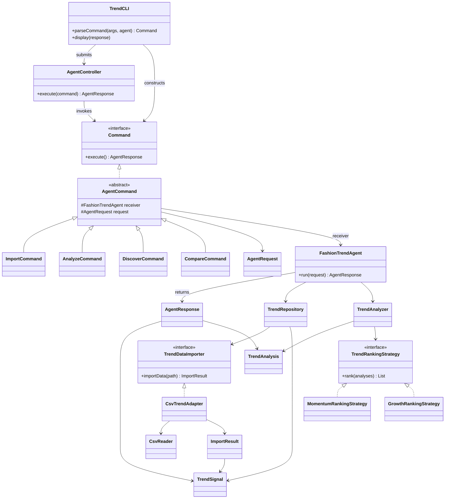
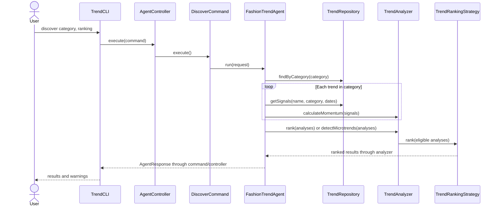

# Implemented architecture

This diagram describes current deterministic functionality, not the still-planned
GUI or LLM integration. A shared response carries data and diagnostics so each
interface can choose its own rendering without repeating application workflows.

Example sequence after CSV import (F06/F07):

Expected I/O and request errors are converted by the controller into unsuccessful
responses. Sparse data is explicit rather than fabricated: rankings exclude it
with warnings, and comparisons retain whatever observations can be analyzed.
