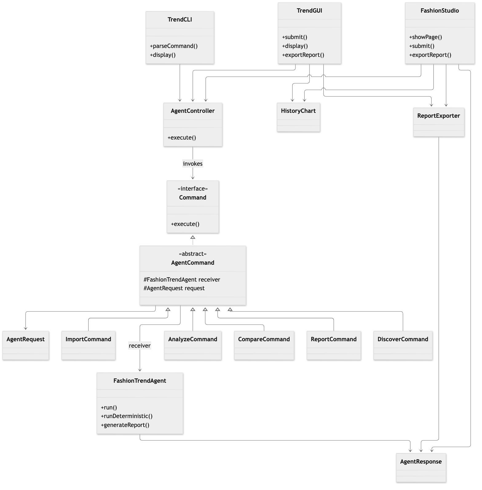
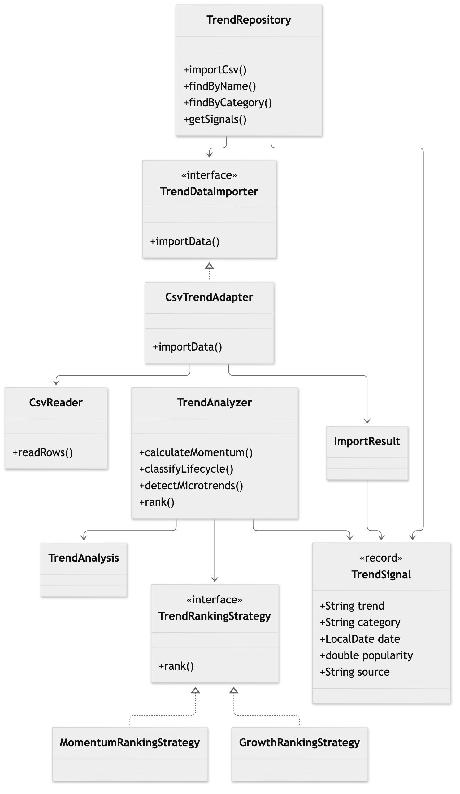
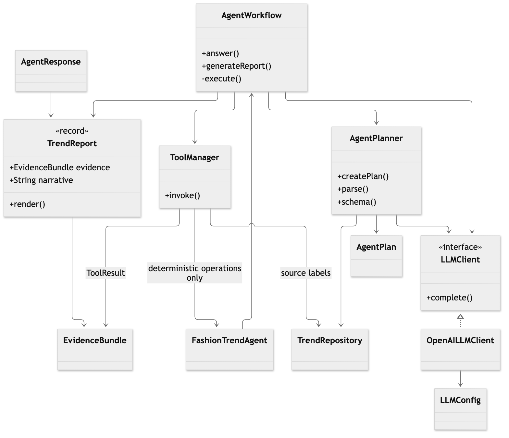
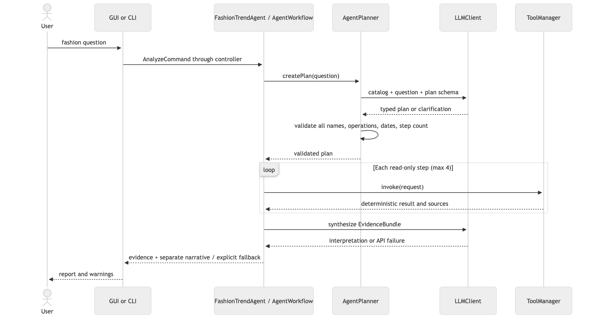
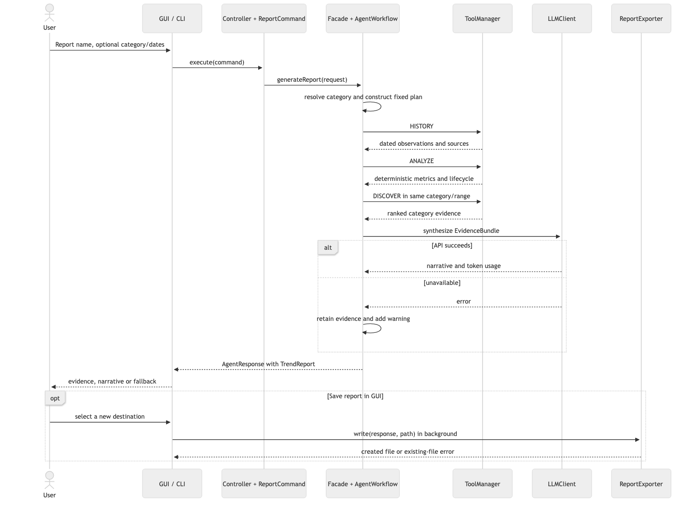
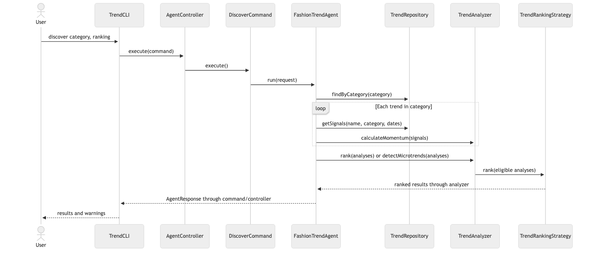
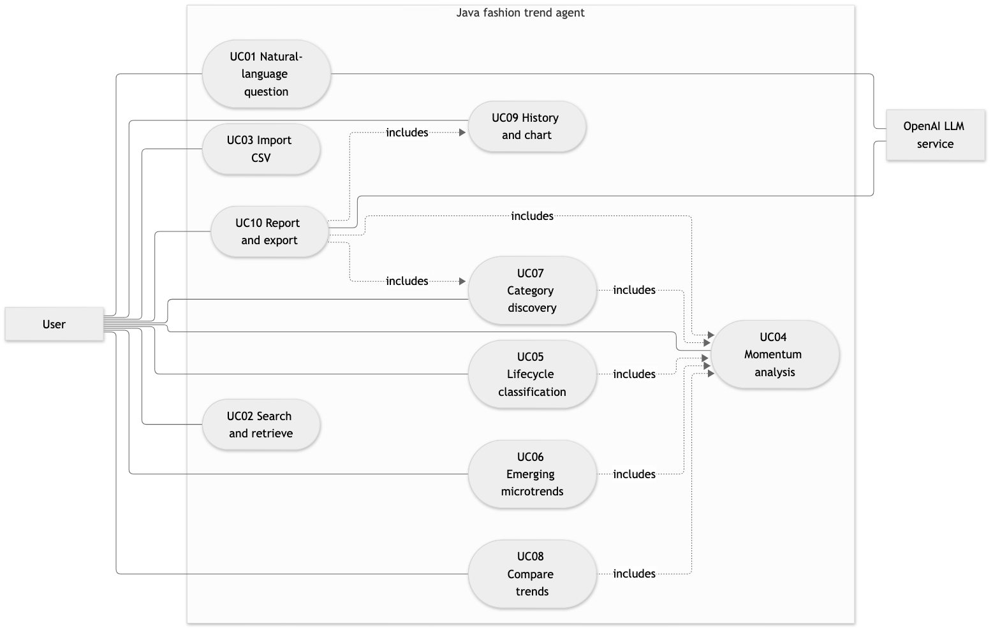

# Stage 2 Implementation Report

Fashion Trend Intelligence + Microtrend Detection Agent — EECS 3311

Author: Yeonseo Lee (220518676). Prepared: November 9, 2026. Submission deadline: November 10, 2026.

**REVIEW DRAFT — complete every item marked TO FILL, then delete this paragraph and rebuild the PDF.** Outstanding: (1) demonstration video links and timestamps in Sections 2 and 7; (2) the actual money paid for AI development tools in Section 5; (3) Claude Code token usage in Section 5; (4) confirmation of student code review and a manual desktop GUI check in Sections 5 and 6.

Repository: [fashion-trend-agent-EECS-3311](https://github.com/yunieyeonseolee/fashion-trend-agent-EECS-3311).
Implementation baseline: [5a2a131](https://github.com/yunieyeonseolee/fashion-trend-agent-EECS-3311/commit/5a2a1312541541048c3abdf359c2beba127711c4).

## 1. Project overview and implementation status

The application helps fashion enthusiasts and content creators examine imported historical fashion signals, compare trends and identify smaller growing styles. It imports local CSV observations, searches and filters histories, calculates deterministic metrics, classifies lifecycle stages, ranks categories, compares trends, plots history and generates evidence-grounded explanations and reports.

The system provides a command-line interface and two Java Swing views: the original `TrendGUI` (`./scripts/gui.sh`) and the task-organized `FashionStudio` (`./scripts/studio.sh`). All three use the same commands, controller and agent facade. Java 17+ is required. Gson 2.13.2 handles JSON, Java HttpClient handles API requests, and shell scripts compile and run the program and download the pinned JSON dependency with checksum verification.

**AI/LLM integration.** Natural-language questions use the OpenAI Responses API with the locally configured model `gpt-6-luna`. The model proposes a structured plan, Java validates the complete plan, read-only tools execute local retrieval and analysis, and a separate model call explains the resulting evidence. Reports for a known trend use a fixed three-step plan. The application therefore plans, uses tools, retains evidence and returns numeric reports when narrative generation fails, rather than forwarding a prompt and displaying the response.

**Status.** All ten Stage 1 feature IDs have working implementations in the GUI and CLI. Seven are recorded as Modified because their behavior or class collaboration differs from Stage 1; Section 4 explains each difference. Five course patterns are implemented: MVC, Command, Facade, Adapter and Strategy. All 149 automated checks pass, and a fresh clone of the repository built and ran on November 9.

**Limitations.** The included dataset is synthetic demonstration data, not measured fashion popularity, and no sample result establishes a real-world trend. Storage is in memory, scoring is heuristic, and generated prose requires review. Ask requires a working LLM connection. Report file export is available only in the GUI. Section 6 lists the remaining limits.

## 2. Feature-to-implementation mapping

Source paths are relative to `src/main/java/fashion/`. Both GUI views and the CLI submit requests through `command/` classes to `application/AgentController` and `application/FashionTrendAgent`; those shared classes are named in a row only where they do feature-specific work.

### F01 — Natural-Language Trend Query

| Mapping field | Entry |
| --- | --- |
| Feature ID and name | F01 — Natural-Language Trend Query |
| Stage 1 feature/reference | F01 / UC01 / SD01 |
| Status or change | Modified (LLM-outage behavior; Section 4.1) |
| Feature type | Hybrid |
| Implemented classes/files and responsibilities | `command/AnalyzeCommand.java` — carries the ASK request. `agent/AgentWorkflow.java` — runs plan, tools, evidence and synthesis in order. `agent/AgentPlanner.java` — requests a plan and rejects invalid ones. `agent/ToolManager.java` — runs only allowlisted read-only operations. `llm/LLMClient.java`, `llm/OpenAILLMClient.java` — model transport boundary and OpenAI implementation. |
| Key methods | `AgentWorkflow.answer()`; `AgentPlanner.createPlan()`, `parse()`; `ToolManager.invoke()`; `LLMClient.complete()` |
| Design patterns | MVC, Command, Facade |
| Video link/timestamp | TO FILL (see Section 7) |

The view submits an ASK request through AnalyzeCommand and AgentController. AgentPlanner sends the question and imported catalog to the model and parses the structured reply. It validates the operation, category and dates of every step, and requires exact catalog names for history, analysis and comparison steps. ToolManager runs up to four read-only operations and AgentWorkflow requests a separate explanation of their calculated evidence. An ambiguous question returns a clarification. Invalid plans and planning outages are explicit errors; a synthesis outage retains the available evidence. A model plan cannot import a file or recursively invoke Ask.

### F02 — Trend Search and Retrieval

| Mapping field | Entry |
| --- | --- |
| Feature ID and name | F02 — Trend Search and Retrieval |
| Stage 1 feature/reference | F02 / UC02 / SD01 |
| Status or change | Implemented |
| Feature type | Deterministic |
| Implemented classes/files and responsibilities | `command/AnalyzeCommand.java` — carries SEARCH and HISTORY requests. `application/FashionTrendAgent.java` — routes the request to the repository. `data/TrendRepository.java` — matches names and filters stored observations. `model/TrendSignal.java` — one normalized observation. |
| Key methods | `TrendRepository.findByName()`, `getSignals()`; `FashionTrendAgent.runDeterministic()` |
| Design patterns | MVC, Command, Facade |
| Video link/timestamp | TO FILL (see Section 7) |

Search normalizes a name fragment and returns matching names. History requests use an exact normalized name with optional category and inclusive date bounds, and the repository returns the matching observations in chronological order. The GUI renders a sortable table and the CLI renders the same response as text. Selecting a GUI result opens analysis or history without retyping; the view row is translated to the underlying model row so sorting cannot select the wrong trend. No match produces an empty-state message.

### F03 — Trend Data Import and Normalization

| Mapping field | Entry |
| --- | --- |
| Feature ID and name | F03 — Trend Data Import and Normalization |
| Stage 1 feature/reference | F03 / UC03 / SD05 |
| Status or change | Implemented |
| Feature type | Deterministic |
| Implemented classes/files and responsibilities | `command/ImportCommand.java` — carries the file path. `data/TrendRepository.java` — stores accepted records and deduplicates repeated imports. `data/TrendDataImporter.java` — importer contract. `data/CsvTrendAdapter.java` — validates rows and builds domain records. `data/CsvReader.java` — parses raw CSV rows. `data/ImportResult.java` — accepted records plus warnings. `model/TrendSignal.java` — normalizes names and categories. |
| Key methods | `TrendRepository.importCsv()`; `CsvTrendAdapter.importData()`; `CsvReader.readRows()`; `TrendSignal.normalize()` |
| Design patterns | MVC, Command, Facade, Adapter |
| Video link/timestamp | TO FILL (see Section 7) |

ImportCommand passes a local path through the facade to the repository, which depends only on TrendDataImporter. CsvTrendAdapter wraps CsvReader, validates required columns, dates, nonblank fields and finite popularity between 0 and 100, and constructs normalized TrendSignal values. Invalid rows generate line-numbered warnings and exact normalized duplicates are skipped. Empty or unreadable files and zero valid observations fail clearly. Multiline CSV fields are unsupported.

### F04 — Trend Momentum Analysis

| Mapping field | Entry |
| --- | --- |
| Feature ID and name | F04 — Trend Momentum Analysis |
| Stage 1 feature/reference | F04 / UC04 / SD01 |
| Status or change | Implemented |
| Feature type | Deterministic |
| Implemented classes/files and responsibilities | `command/AnalyzeCommand.java` — carries the ANALYZE request. `application/FashionTrendAgent.java` — retrieves the history and invokes analysis. `analysis/TrendAnalyzer.java` — calculates growth, acceleration and momentum. `model/TrendAnalysis.java` — holds the metrics and reliability state. |
| Key methods | `TrendAnalyzer.calculateMomentum()`; `TrendAnalysis.reliable()` |
| Design patterns | MVC, Command, Facade |
| Video link/timestamp | TO FILL (see Section 7) |

The facade retrieves one trend and category history and passes it to TrendAnalyzer. Same-date values are averaged, dates are sorted, and interval-based growth and acceleration are calculated. A weighted, clamped score becomes the momentum value. Fewer than three distinct dates yields Unknown and unavailable metrics rather than fabricated values. A name spanning several categories is rejected until the user selects one. Section 4.4 gives the exact rules.

### F05 — Trend Lifecycle Classification

| Mapping field | Entry |
| --- | --- |
| Feature ID and name | F05 — Trend Lifecycle Classification |
| Stage 1 feature/reference | F05 / UC05 / SD01 |
| Status or change | Modified (AI explanation moved to Ask/Report; Section 4.1) |
| Feature type | Hybrid: deterministic classification, optional AI explanation |
| Implemented classes/files and responsibilities | `analysis/TrendAnalyzer.java` — applies the lifecycle rules. `model/TrendAnalysis.java` — carries the assigned stage. `agent/AgentWorkflow.java`, `llm/LLMClient.java` — explain a calculated stage on request. |
| Key methods | `TrendAnalyzer.classifyLifecycle()`; `AgentWorkflow.answer()`, `generateReport()` |
| Design patterns | MVC, Command, Facade |
| Video link/timestamp | TO FILL (see Section 7) |

After computing momentum, TrendAnalyzer applies fixed rules and attaches Emerging, Growing, Peaking or Declining to TrendAnalysis; insufficient observations yield Unknown. The label appears with analysis, discovery and comparison results. Ask or Report can explain the calculated label using the LLM, but model text never changes it.

### F06 — Emerging Microtrend Detection

| Mapping field | Entry |
| --- | --- |
| Feature ID and name | F06 — Emerging Microtrend Detection |
| Stage 1 feature/reference | F06 / UC06 / SD02 |
| Status or change | Modified (AI summary moved to Ask/Report; Section 4.1) |
| Feature type | Hybrid: deterministic detection, optional AI explanation |
| Implemented classes/files and responsibilities | `command/DiscoverCommand.java` — carries the EMERGING request. `application/FashionTrendAgent.java` — gathers category candidates and warnings. `data/TrendRepository.java` — supplies candidate histories. `analysis/TrendAnalyzer.java` — filters qualifying microtrends. `analysis/TrendRankingStrategy.java` — orders the results. |
| Key methods | `FashionTrendAgent.discover()`; `TrendAnalyzer.detectMicrotrends()`, `rank()` |
| Design patterns | MVC, Command, Facade, Strategy |
| Video link/timestamp | TO FILL (see Section 7) |

The facade finds category candidates, retrieves their histories and calculates metrics. It excludes insufficient histories with warnings and keeps trends with low latest popularity, strong recent growth and positive momentum. The selected strategy orders them. Ask can select EMERGING as a tool and explain the results. No qualifying trend produces a clear empty state. Thresholds are provisional heuristics, not evidence of future commercial success.

### F07 — Category-Based Trend Discovery

| Mapping field | Entry |
| --- | --- |
| Feature ID and name | F07 — Category-Based Trend Discovery |
| Stage 1 feature/reference | F07 / UC07 / SD02 |
| Status or change | Modified (AI summary moved to Ask/Report; Section 4.1) |
| Feature type | Hybrid: deterministic ranking, optional AI explanation |
| Implemented classes/files and responsibilities | `command/DiscoverCommand.java` — carries category and ranking choice. `data/TrendRepository.java` — lists trends in the category. `analysis/TrendAnalyzer.java` — calculates metrics and delegates ranking. `analysis/MomentumRankingStrategy.java`, `analysis/GrowthRankingStrategy.java` — interchangeable orderings. |
| Key methods | `TrendRepository.findByCategory()`; `FashionTrendAgent.discover()`; `TrendAnalyzer.rank()` |
| Design patterns | MVC, Command, Facade, Strategy |
| Video link/timestamp | TO FILL (see Section 7) |

A category request retrieves all named candidates and analyzes each usable history with the same analyzer. Ranking delegates to descending momentum or descending short-term growth, with deterministic tie-breaking. Sparse histories are excluded with warnings, and unsupported categories return the available category names. Reports reuse category discovery to provide related-trend context.

### F08 — Trend Comparison

| Mapping field | Entry |
| --- | --- |
| Feature ID and name | F08 — Trend Comparison |
| Stage 1 feature/reference | F08 / UC08 / SD03 |
| Status or change | Modified (AI summary moved to Ask/Report; AgentResponse replaces ComparisonResult; Section 4.1) |
| Feature type | Hybrid: deterministic comparison, optional AI explanation |
| Implemented classes/files and responsibilities | `command/CompareCommand.java` — carries two names and optional dates. `application/FashionTrendAgent.java` — analyzes each side and retains partial results. `analysis/TrendAnalyzer.java` — applies identical calculations to both. `application/AgentResponse.java` — carries both analyses and warnings. |
| Key methods | `FashionTrendAgent.compare()`; `TrendAnalyzer.calculateMomentum()` |
| Design patterns | MVC, Command, Facade |
| Video link/timestamp | TO FILL (see Section 7) |

CompareCommand supplies two names and optional shared date bounds. The facade retrieves each history, applies the same calculations independently and returns both analyses in one response. One missing or sparse trend produces a partial comparison with warnings; two missing histories produce an error. A name spanning several categories is rejected with a request to select one. The GUI can fill the second trend from a selected result.

### F09 — Trend History and Visualization

| Mapping field | Entry |
| --- | --- |
| Feature ID and name | F09 — Trend History and Visualization |
| Stage 1 feature/reference | F09 / UC09 / SD04 |
| Status or change | Modified (presentation of missing periods; Section 4.1) |
| Feature type | Deterministic |
| Implemented classes/files and responsibilities | `command/AnalyzeCommand.java` — carries the HISTORY request. `data/TrendRepository.java` — returns chronologically sorted observations. `gui/TrendGUI.java`, `gui/FashionStudio.java` — display the table and chart. `gui/HistoryChart.java` — draws date-spaced points. `cli/TrendCLI.java` — prints the observations. |
| Key methods | `TrendRepository.getSignals()`; `TrendGUI.display()`; `FashionStudio.render()`; `HistoryChart.setSignals()`, `paintComponent()` |
| Design patterns | MVC, Command, Facade |
| Video link/timestamp | TO FILL (see Section 7) |

History retrieves sorted observations using the optional category and date range. The CLI prints them; the GUI shows a table and a date-spaced point plot on a 0–100 scale. The chart averages same-date observations and draws points only for observed dates, with a caption stating that unobserved dates have no points. A name spanning several categories requires a category selection before plotting, though the table still lists all records. Empty histories show an empty-state message instead of a chart.

### F10 — AI Trend Intelligence Report

| Mapping field | Entry |
| --- | --- |
| Feature ID and name | F10 — AI Trend Intelligence Report |
| Stage 1 feature/reference | F10 / UC10 / SD06 |
| Status or change | Modified (fixed plan; report export added; Section 4.1) |
| Feature type | Hybrid |
| Implemented classes/files and responsibilities | `command/ReportCommand.java` — carries the report request. `agent/AgentWorkflow.java` — builds the plan and assembles the result. `agent/ToolManager.java` — runs each evidence step. `agent/EvidenceBundle.java` — tool results and sources. `agent/TrendReport.java` — keeps narrative, numbers and usage separate. `llm/LLMClient.java` — synthesizes the narrative. `export/ReportExporter.java` — saves the report as text. |
| Key methods | `FashionTrendAgent.generateReport()`; `AgentWorkflow.generateReport()`, `execute()`; `ToolManager.invoke()`; `TrendReport.render()`; `ReportExporter.write()` |
| Design patterns | MVC, Command, Facade, Strategy (category evidence) |
| Video link/timestamp | TO FILL (see Section 7) |

For an exact trend, AgentWorkflow resolves its category and builds a fixed HISTORY, ANALYZE, DISCOVER plan over one date range. Tool results and sources form an EvidenceBundle, LLMClient synthesizes that evidence, and TrendReport keeps the narrative separate from numerical results and API usage. A missing trend or ambiguous category fails clearly; unavailable synthesis returns numeric evidence with warnings. The GUI saves finished reports as UTF-8 text without another API call, preserves warnings and refuses to overwrite files. Export extends F10 and is not counted as an additional feature.

## 3. Implemented design patterns

### MVC

- **Design problem:** a GUI and a CLI must expose the same behavior without duplicating scoring or data logic.
- **Participants and roles:** TrendGUI, FashionStudio, HistoryChart and TrendCLI are views. AgentController is the controller. TrendRepository, TrendSignal, TrendAnalysis and TrendReport are the model.
- **Sources and methods:** `gui/TrendGUI.java` (`submit()`, `display()`), `gui/FashionStudio.java` (`submit()`, `render()`), `gui/HistoryChart.java`, `application/AgentController.java` (`execute()`), `data/TrendRepository.java`, `model/*.java`.
- **How it follows the pattern and why it is useful:** views collect input and render responses on the event thread, with work performed in a SwingWorker. The controller converts expected failures to AgentResponse. No view parses CSV or implements a momentum formula, which is why a second GUI could be added without changing scoring.
- **Match with Stage 1:** matches in intent; FashionStudio is an added view and the Trend class was removed (Section 4.3).

### Command

- **Design problem:** GUI and CLI operations need a common invocation contract without duplicated control flow.
- **Participants and roles:** Command is the command interface. AgentCommand is the abstract base holding the receiver and request. ImportCommand, AnalyzeCommand, DiscoverCommand, CompareCommand and ReportCommand are concrete commands. FashionTrendAgent is the receiver and AgentController the invoker.
- **Sources and methods:** `command/*.java` (`execute()`), `application/AgentRequest.java`.
- **How it follows the pattern and why it is useful:** each interface builds a command object and hands it to the invoker, so the same commands run from all views and in tests. AgentCommand checks that each concrete command receives only its permitted operations.
- **Match with Stage 1:** matches the proposed roles; an operation enum selects behavior within a concrete command (Section 4.3).

### Facade

- **Design problem:** one request can require retrieval, ranking, several tools, model calls and fallback behavior.
- **Participants and roles:** FashionTrendAgent is the facade. AgentWorkflow, AgentPlanner, ToolManager, LLMClient, TrendRepository and TrendAnalyzer are subsystem classes.
- **Sources and methods:** `application/FashionTrendAgent.java` (`run()`, `runDeterministic()`, `generateReport()`), `agent/AgentWorkflow.java` (`answer()`, `generateReport()`).
- **How it follows the pattern and why it is useful:** commands call one high-level receiver and do not need to know the order of the lower-level steps or how each one fails.
- **Match with Stage 1:** retained, with AI orchestration delegated to the added AgentWorkflow (Section 4.3).

### Adapter

- **Design problem:** CSV strings and inconsistent formatting cannot be stored or analyzed directly.
- **Participants and roles:** TrendDataImporter is the target. CsvTrendAdapter is the adapter. CsvReader is the adaptee. TrendRepository is the client.
- **Sources and methods:** `data/TrendDataImporter.java`, `data/CsvTrendAdapter.java` (`importData()`), `data/CsvReader.java` (`readRows()`), `data/TrendRepository.java` (`importCsv()`).
- **How it follows the pattern and why it is useful:** the adapter converts raw rows from the reader into validated TrendSignal records behind the importer interface. The repository depends only on that interface, so another source format would not change scoring or views.
- **Match with Stage 1:** matches.

### Strategy

- **Design problem:** discovery results must be ordered by momentum or recent growth without ranking branches in every consumer.
- **Participants and roles:** TrendRankingStrategy is the strategy interface. MomentumRankingStrategy and GrowthRankingStrategy are concrete strategies. TrendAnalyzer is the context.
- **Sources and methods:** `analysis/TrendRankingStrategy.java` (`rank()`), `analysis/MomentumRankingStrategy.java`, `analysis/GrowthRankingStrategy.java`, `analysis/TrendAnalyzer.java` (`rank()`), `application/FashionTrendAgent.java` (`runDeterministic()`).
- **How it follows the pattern and why it is useful:** TrendAnalyzer receives a strategy at construction and delegates ordering to it. Each strategy excludes unreliable results and breaks ties deterministically. Lifecycle and momentum remain sequential calculations, not competing strategies.
- **Match with Stage 1:** matches in intent; a request-specific analyzer replaces switching the strategy on a long-lived object (Section 4.3).

The updated class diagram is split into three readable views in Appendix A, alongside updated sequence diagrams for query, report and discovery and an updated use-case view. Sources are under `docs/diagrams/`.

## 4. Changes and rationale

No Stage 1 feature was removed or replaced. All five design patterns were retained. The tables below use the structure Original design, Implemented change, Reason, Impact.

### 4.1 Feature changes

| Original design | Implemented change | Reason | Impact |
| --- | --- | --- | --- |
| F01 / UC01: if the LLM is unavailable, show deterministic results when the query can still be resolved | Planning failure returns an explicit error directing the user to the direct commands | Without a validated plan, the system cannot safely infer which tools a free-text question needs | User need is met through History, Analyze and Report without an LLM. Affects UC01, `AgentWorkflow.answer()`, `AgentPlanner.createPlan()`. Patterns unchanged |
| F05 / UC05: LLM may explain the classification alongside analysis | Direct commands stay deterministic; explanation is requested through Ask or Report | Avoids an API call and cost on every analysis | User can still get the explanation in one step; the label cannot be altered by model text. Affects UC05, `TrendAnalyzer.classifyLifecycle()`, `AgentWorkflow`. Patterns unchanged |
| F06 / UC06, F07 / UC07: LLM summarizes ranked results | Rankings stay deterministic; Ask selects EMERGING or DISCOVER as tools and explains the results | Same as F05; rankings remain usable offline | User need is met through Ask. Affects UC06, UC07, `FashionTrendAgent.discover()`, `ToolManager.invoke()`. Strategy unchanged |
| F08 / UC08: `TrendAnalyzer.compare()` builds ComparisonResult and LLM explains differences | Facade analyzes each side; AgentResponse carries results and warnings; Ask selects COMPARE to explain | One response type can carry partial results and warnings | Side-by-side and partial comparison retained. Affects UC08, SD03, `FashionTrendAgent.compare()`, `AgentResponse`. The analyzer's `compare()` helper is not the production path |
| F09 / UC09: missing periods shown as unavailable | Points appear only on observed dates, positioned by real date spacing, with a caption stating unobserved dates have no points | Avoids implying values for periods with no data | Gaps stay visible and no values are invented; no explicit unavailable marker is drawn. Affects UC09, SD04, `HistoryChart.paintComponent()` |
| F10 / UC10: AgentPlanner creates the report plan | Known-trend reports use a fixed HISTORY, ANALYZE, DISCOVER plan | A model planning call would add cost for steps that are always the same | Report contents unchanged, and F01 still uses model plans. Affects UC10, SD06, `AgentWorkflow.generateReport()` |
| New (extends F10): report display only | Added ReportExporter and Save report in the GUI | Lets users keep a report without another API call | Preserves warnings and refuses to overwrite. Extends UC10; adds `ReportExporter.write()`. Not counted as a new feature |
| New (extends F02, F04, F08, F09): retyping names between views | Added selected-result navigation and summary cards | Reduces repeated input in multi-step analysis | Respects sort order. Affects `TrendGUI`, `FashionStudio`. No scoring change; not counted as a new feature |
| New: one GUI proposed | Added FashionStudio, an alternate Swing view grouping features into Explore, Discover, Compare and AI reports | User review requested clearer task-focused navigation | Reuses controller, commands, agent, chart and exporter, and adds no scoring or LLM behavior. Adds `FashionStudio` as an MVC view |

### 4.2 Architecture and class changes

| Original design | Implemented change | Reason | Impact |
| --- | --- | --- | --- |
| Facade coordinates every AI step | Added AgentWorkflow behind FashionTrendAgent | Keeps orchestration from overloading the facade | Affects F01 and F10 sequence diagrams |
| ToolManager invokes repository and analyzer for every operation, including imports | ToolManager is used only for Ask and Report steps and calls `runDeterministic()`; direct commands go straight to the facade | Reuses direct-request behavior and keeps imports out of model reach | Model plans cannot import files or call AI operations. Affects UC02–UC04, UC06, UC07, UC09 flows |
| `LLMClient.interpret()`, `explain()`, `generateReport()` | Single `LLMClient.complete(instructions, input, schema)` | One testable transport boundary supports typed plans and prose | Planner and workflow own their prompts; `gpt-6-luna` remains the verified model and is configurable |
| `TrendGUI.submitQuery()`, `showHistory()` | One `submit()` driven by the selected operation; `display()` renders results | Operations share one form and worker | Less duplicated UI code. Affects F01 and F09 |
| Trend domain class | Name and category stay in TrendSignal | Avoids redundant state | Model is smaller; class diagram updated |
| CSV import result returned as counts and warnings | Added immutable ImportResult | Accepted records and diagnostics travel together | Repeated imports deduplicate in memory |
| CSV normalization not specified in detail | Explicit 0–100 popularity, normalized names and categories, one record per line | Rejects nonfinite and out-of-range input | Quoted commas supported; multiline fields unsupported |
| Numeric formulas not specified | Documented growth, acceleration, momentum and lifecycle rules (Section 4.4) | Results must be reproducible | Deterministic output, disclosed as provisional heuristics |
| GUI toolkit and build tooling not specified | Swing with background workers; shell scripts with pinned Gson | Standard Java desktop components; no Maven needed | Report tooling in Python is documentation-only |

### 4.3 Design pattern changes

All five patterns from Stage 1 remain; none was replaced. Four were adjusted as follows.

| Original pattern | Pattern as implemented, participants and roles | Design problem and reason | Impact on architecture |
| --- | --- | --- | --- |
| MVC: TrendGUI view; Trend among the model classes | MVC: TrendGUI, FashionStudio, HistoryChart and TrendCLI views; AgentController controller; TrendRepository, TrendSignal, TrendAnalysis, TrendReport model | Multiple presentations share one workflow; the Trend class added no behavior | A second GUI required no model or controller changes |
| Command: one concrete class per operation family | Command: same classes and roles; AgentRequest operation enum selects behavior within a command | Search, history, analysis and Ask share one request shape | AgentCommand validates permitted operations; fewer classes |
| Facade: FashionTrendAgent directly coordinates all components | Facade: FashionTrendAgent remains the facade; AgentWorkflow coordinates AgentPlanner, ToolManager and LLMClient behind it | Separates deterministic routing from AI orchestration and fallback | Facade stays small; AI flow is testable with a fake LLMClient |
| Strategy: TrendAnalyzer can switch strategy | Strategy: same interface and concrete strategies; facade creates an analyzer per request | Avoids mutating shared state between background requests | Same interchangeability; strategy chosen from AgentRequest.Ranking |

### 4.4 Analysis rules and limitations

For a single trend and category, values on the same date are averaged. At least three distinct dates are needed. Given before and after popularity a and b and elapsed days d, growth is `(b - a) / max(a, 1) * 100 * 30 / d`: linear percent change per 30 days, not compounded growth. Short growth uses the last interval; long growth uses first to last. Acceleration is short growth minus the preceding interval's growth. Momentum is `clamp(0.5 * short + 0.3 * long + 0.2 * acceleration, -100, 100)`.

Lifecycle checks run in order: Declining if short growth or momentum is below -5; otherwise Emerging if latest popularity is below 40, short growth is at least 10 and momentum is positive; otherwise Growing if short growth exceeds 5 and momentum is positive, except when popularity is at least 70 and acceleration is negative; otherwise Peaking. Fewer than three dates gives Unknown. Microtrends require popularity below 40, short growth at least 10 and positive momentum.

These are provisional rules, not empirically validated lifecycle states. The four-stage model labels flat low-popularity series Peaking, which is a known limitation. Same-source and same-date conflicts are retained and averaged, and all observations have equal weight. Comparison applies the same bounds and formulas but does not enforce identical observation dates. The one-point baseline floor prevents division by zero but changes interpretation near zero.

## 5. AI tools and collaboration log

### Development tools

| Tool or platform | LLM/model | Features, classes or tasks | Total tokens | Money cost |
| --- | --- | --- | --- | --- |
| Codex, with the OpenAI Docs skill | gpt-6-astra | Requirements interpretation; all Java implementation (F01–F10, all five patterns); tests; GUI iteration; API integration; diagrams; first report draft | 15,874,218 (15,757,848 input, of which 15,332,992 cached; 116,370 output, including 11,253 reasoning) | TO FILL: actual amount paid or subscription plan. About US$25.40 at list price (estimate) |
| Claude Code | Claude Opus 5.5 | November 9 requirements audit, fresh-clone verification, and revision of this report and its PDF builder; no application code changed | TO FILL: from the session usage record | TO FILL: actual amount paid or subscription plan |

Codex figures come from the local session record covering November 5–7, 2026, which matches the implementation commit window. The figure is session-level. The session's recorded working directory was the student's separate fashion-search folder, but its activity refers to this repository and that other repository received no commits during the window.

The list-price estimate applies US$10 per million uncached input tokens, US$1 per million cached input tokens and US$50 per million output tokens. These rates were taken from third-party pricing trackers on November 9 and are an estimate of equivalent API cost, not a billed amount.

Representative interactions and resulting work:

- Student supplied the Stage 2 instructions and Stage 1 repository; Codex inspected the design and started the CSV and retrieval foundations.
- Student selected Java following the instructor's reminder; the implementation uses Java rather than the stack of the separate fashion-search project.
- Student requested weekly commit recording after missing two periods; the records preserve those missed periods and link subsequent meaningful commits.
- Student asked to continue; shared commands and facade, Swing GUI, model planning and reports, and report export were implemented and tested in successive milestones.
- Student configured the API key locally and requested verification; live Ask and Report tests succeeded without exposing or committing the credential.
- Student rejected the added branding, serif typography and layout proportions of the alternate GUI; these were corrected and retested.
- Student asked Claude Code to check the project against the Stage 2 instructions; the audit found report statements that did not match Stage 1, which are corrected in Section 4.

The representative collaboration interactions are recorded above.

Human review: TO FILL: confirm that the student reviewed the AI-generated code and can explain the five patterns. Passing tests are not presented as evidence of human review.

### Runtime LLM usage, separate from development tools

The OpenAI Responses API with configured model `gpt-6-luna` powers natural-language planning and evidence synthesis. On November 5, Ask used 368 input and 136 output tokens for planning and 551 input and 411 output for synthesis. Report synthesis used 816 input and 568 output. Total recorded usage for these three calls is **1,735 input + 1,115 output = 2,850 tokens**, about US$0.0007 at the list price of US$0.10 per million input and US$0.50 per million output tokens (estimate from third-party pricing trackers, not a billed amount). Usage from recording the demonstrations is not included.

The live test explanations cited tool steps and synthetic source labels. The Ask prose loosely described negative acceleration as easing momentum, whereas the implemented metric measures change in growth rate, which illustrates why generated prose needs review. See [docs/live-verification.md](docs/live-verification.md). Official implementation references: [Structured Outputs](https://developers.openai.com/api/docs/guides/structured-outputs) and [GPT-6 Luna](https://developers.openai.com/api/docs/models/gpt-6-luna).

## 6. Development and verification summary

### Weekly commit summary

Dates are Toronto local time. Commit tracking began November 5, 2026. The first two reporting periods were missed and no retrospective activity is claimed. The assignment specifies a single five-point deduction for failing any weekly minimum, and later commits do not compensate for earlier periods.

| Reporting period | Required meaningful code commits | Recorded | Status |
| --- | --- | --- | --- |
| October 20–26, 2026 | 5 | 0 | Missed |
| October 27–November 2, 2026 | 5 | 0 | Missed |
| November 3–9, 2026 | 5 | 8 | Minimum met |

| Date | Code commit | Implementation and verification |
| --- | --- | --- |
| November 5, 2026 | [82487e6 — Implement Java trend data pipeline, analysis, and CLI](https://github.com/yunieyeonseolee/fashion-trend-agent-EECS-3311/commit/82487e6f59989815f13715d07f3cb15353d91477) | CSV data pipeline, repository, deterministic analytics and ranking, CLI and tests. Passed 36 behavioral checks and 8 CLI smoke and error checks. |
| November 5, 2026 | [da69374 — Route trend operations through shared commands and agent facade](https://github.com/yunieyeonseolee/fashion-trend-agent-EECS-3311/commit/da69374eb18990c4159d314e0292e5984f4effa5) | Shared controller, Command and Facade workflow, immutable responses and partial comparison handling. Passed 55 behavioral checks and 8 CLI checks. |
| November 5, 2026 | [c833d11 — Add Swing GUI with shared workflows and trend history chart](https://github.com/yunieyeonseolee/fashion-trend-agent-EECS-3311/commit/c833d112f72da0f95d885efe233a824d8b9b0464) | Swing GUI using shared commands, background execution, results, errors and history chart. Passed 73 checks including 18 Swing checks. |
| November 5, 2026 | [9f28aa9 — Integrate validated LLM plans and evidence-grounded trend reports](https://github.com/yunieyeonseolee/fashion-trend-agent-EECS-3311/commit/9f28aa974a7c0f915913e42242896c5ecd945dbc) | LLM planning and tools, evidence reports and GUI and CLI integration. Passed 108 checks and 8 CLI regressions. |
| November 6, 2026 | [0c6efff — Add selected-trend navigation and safe report export to GUI](https://github.com/yunieyeonseolee/fashion-trend-agent-EECS-3311/commit/0c6efff273b328f5fd621086d41064086365a8cc) | Selected-trend navigation and report export with overwrite protection. Passed 128 checks including 37 Swing and 4 export checks. |
| November 6, 2026 | [5c51f96 — Polish Swing dashboard with selected-trend summaries and accessible controls](https://github.com/yunieyeonseolee/fashion-trend-agent-EECS-3311/commit/5c51f96138cdf4c33d0c0beb9795ddc37aa5f98f) | Summary cards follow sorted selections and clear on errors; scrolling controls and progress feedback. Passed 132 checks including 41 Swing checks. |
| November 7, 2026 | [d49d45d — Add Atelier fashion studio with task-focused navigation and separate AI evidence views](https://github.com/yunieyeonseolee/fashion-trend-agent-EECS-3311/commit/d49d45d2540fcf3938f9476bdbfe59ef799ed8ec) | Alternate FashionStudio view with task navigation and separate narrative and evidence tabs. Passed 147 checks including 15 alternate-view checks. |
| November 7, 2026 | [cdaf275 — Remove UI branding and correct typography, spacing, and table proportions](https://github.com/yunieyeonseolee/fashion-trend-agent-EECS-3311/commit/cdaf27597248124d991e8b28aa5bf1f9aaa54a86) | Revised branding, font and layout following user feedback. All 147 checks passed. |

All eight commits were pushed to origin/main on their listed dates. Documentation-only commits are excluded. [5a2a131](https://github.com/yunieyeonseolee/fashion-trend-agent-EECS-3311/commit/5a2a1312541541048c3abdf359c2beba127711c4) (November 7) is a one-line UI label change and is also not counted.

Post-period update — November 15, 2026: [b78f500 — Treat valid empty agent tool results as successful answers](https://github.com/yunieyeonseolee/fashion-trend-agent-EECS-3311/commit/b78f5007b83fb174701279ad9f96fbf46d57dbdf) was committed and pushed after all 149 local checks passed. This update is outside the required weekly periods and does not increase their counts.

### Verification performed

The automated suite runs **149 checks**: 17 data-layer, 19 analysis, 19 shared workflow, 41 original Swing GUI, 34 LLM integration, 4 report export and 15 alternate GUI checks. Run `./scripts/test.sh`. Tests cover malformed CSV, date and value handling, exact deduplication, filtering, known rising, falling and flat histories, irregular intervals, zero baselines, sparse histories, strategy differences, shared responses, partial comparisons, sorted GUI selection, background execution, report export and overwrite and failure recovery.

API tests use a local fake HTTP server and test doubles. They cover request schema and authentication, incomplete, refused and malformed responses, invalid tool names, dates and catalog entries, step limits, clarification and numeric fallback. They do not spend credits or prove real-model availability. Separately, live Ask and Report smoke tests succeeded with actual `gpt-6-luna` requests on November 5 (Section 5).

On November 9, a fresh clone of commit 5a2a131 with no local configuration passed all 147 checks. In that clone, CLI import, search, history, analyze, discover, emerging and compare produced correct output, including no-match, unknown-category and partial-comparison cases. Without an API key, Ask returned the configuration error and Report returned numeric evidence with the AI interpretation marked unavailable. The same day, a scan of all commits found no common API-key patterns, and no `.env` file has ever been committed.

Defects found and corrected include a mis-escaped CSV quote in a Java test fixture, missing table headers in headless rendering, cramped result spacing in the alternate GUI, and Ask reporting a valid empty result (a category with no emerging trends) as an error. That last defect was found in a live run on November 9; the correction keeps real tool failures as errors and added two checks. Navigation tests verify that sorting does not cause the GUI to act on the wrong row. Export tests verify that existing files are unchanged and warnings remain in offline reports.

Manual desktop check: TO FILL: confirm native window, file-picker and export behavior after running the application on the desktop. Automated Swing checks run headlessly and do not cover native dialogs.

### Remaining limitations

- Data persists only for the current process, and sample observations are synthetic. Real data must use a comparable documented popularity scale.
- CSV multiline fields are unsupported. Scoring and lifecycle thresholds are heuristic, including the flat-series limitation in Section 4.4.
- Ask requires a working API connection for planning; without one, users must use the direct commands.
- Plans are limited to four read-only steps and a catalog of up to 200 sorted trend names. Evidence over 60,000 serialized characters skips synthesis with a warning.
- Each model call has a 60-second timeout and a 2,000 output-token cap. Generated prose is not automatically fact-verified.
- Stage 3's full deterministic and KUMA validation is not claimed as completed here.

## 7. Demonstration index

Each feature is demonstrated in the running application. Collectively the recordings show both the GUI and CLI, including report export and representative error cases.

| Feature | Demonstration | Video link / start timestamp |
| --- | --- | --- |
| F01 Natural-language query | Ask about mary jane flats; show plan, tool evidence and real interpretation | TO FILL |
| F02 Search/retrieval | Search mary; open selected history; show no-match behavior | TO FILL |
| F03 Import/normalization | Import sample CSV and an invalid-row fixture; show counts and warnings | TO FILL |
| F04 Momentum | Analyze mary jane flats; explain the calculated values and sparse-history case | TO FILL |
| F05 Lifecycle | Show Growing, Declining and Emerging examples and Unknown for sparse data | TO FILL |
| F06 Microtrend detection | Emerging accessories yields bag charms; empty footwear result | TO FILL |
| F07 Category discovery | Rank footwear by momentum and growth; unsupported category error | TO FILL |
| F08 Comparison | Compare mary jane flats and chunky sneakers; show partial missing-trend result | TO FILL |
| F09 History visualization | Plot mary jane flats, filter dates and show matching CLI observations | TO FILL |
| F10 Intelligence report | Generate real report, show sources and related evidence, save text, show overwrite rejection | TO FILL |
| Alternate GUI (FashionStudio) | Walk through Explore, Discover, Compare, AI reports and sidebar import | TO FILL |

## Appendix A. Updated diagrams

The class diagram is partitioned by responsibility for legibility; repeated classes identify cross-view connections. Arrows show dependencies, inheritance or interface realization as labeled. Mermaid sources and rendered figures are committed under docs/diagrams. The complete source-level relationship overview also remains in docs/architecture.md.

### A1. Interface, controller and command classes

### A2. Data adaptation and analysis classes

### A3. Agent and LLM classes

### A4. Natural-language query sequence

### A5. Report and export sequence

### A6. Category discovery sequence

### A7. Updated use-case view

AI explanations for F05–F08 are requested through UC01 or UC10; standalone operations remain deterministic. Export extends UC10 rather than adding a new counted use case. The LLM is an external actor for the two AI workflows.
