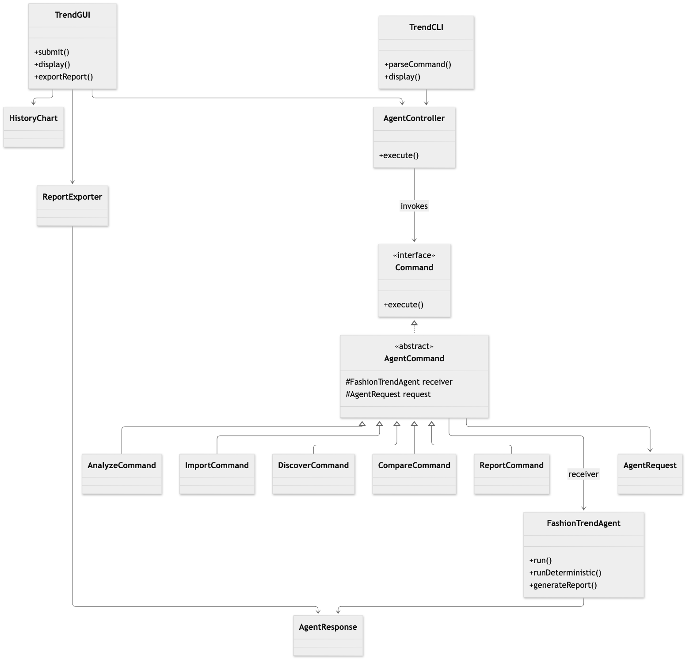
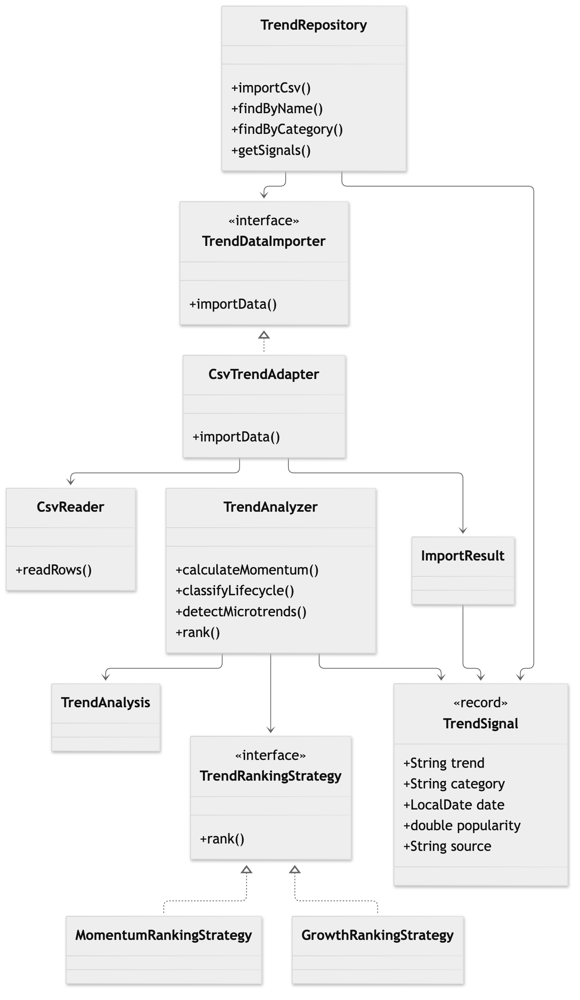
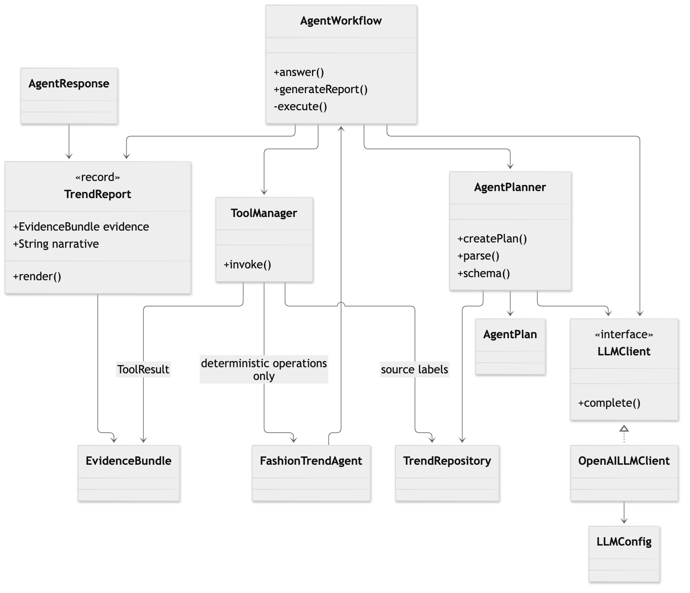
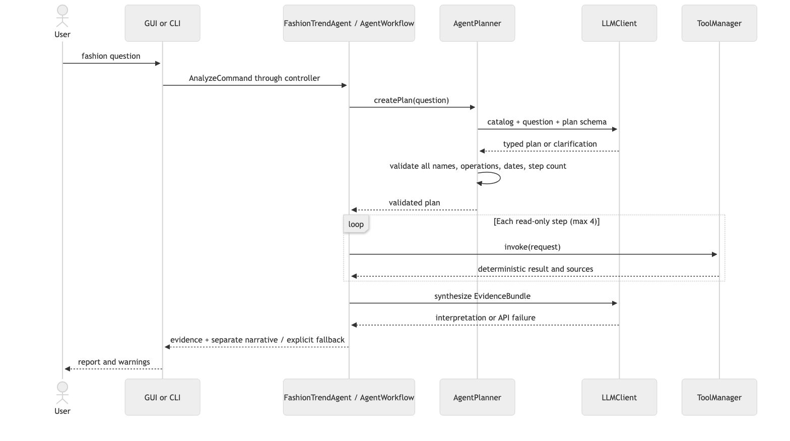
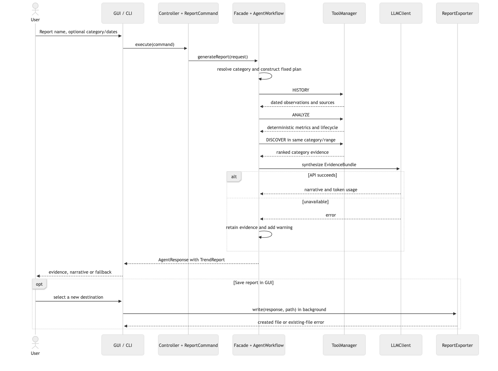
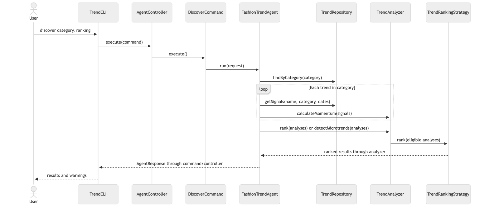
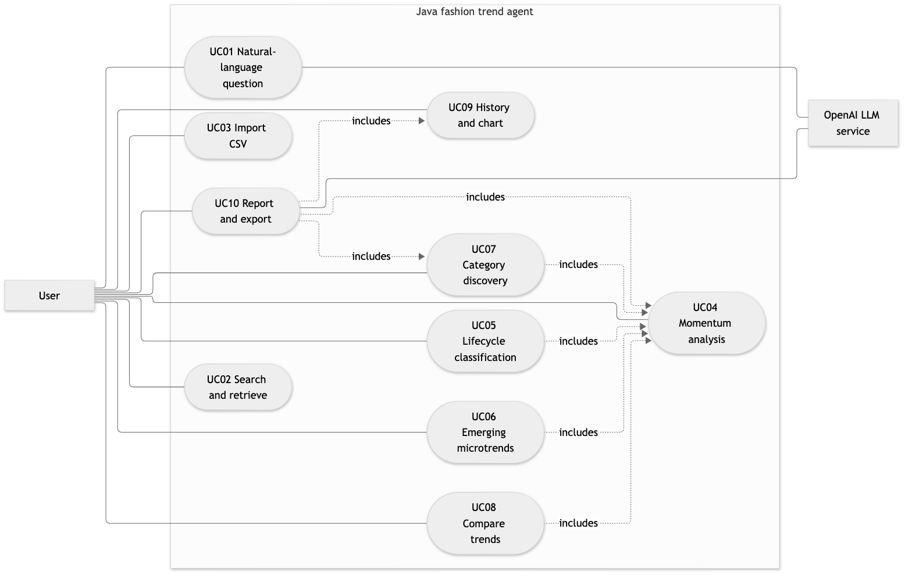

# Stage 2 Implementation Report

Fashion Trend Intelligence + Microtrend Detection Agent — EECS 3311

Author: Yeonseo Lee. Prepared: November 6, 2026. Submission deadline: November 10, 2026.

**REVIEW DRAFT — not ready for final submission.** Application functionality is implemented and basic verification has passed. Demonstration videos, exact coding-tool model/usage/cost records, student review and a manual desktop check are still pending. These items are explicitly identified below; no unavailable evidence is claimed.

Repository: [fashion-trend-agent-EECS-3311](https://github.com/yunieyeonseolee/fashion-trend-agent-EECS-3311).
Implementation baseline: [0c6efff](https://github.com/yunieyeonseolee/fashion-trend-agent-EECS-3311/commit/0c6efff273b328f5fd621086d41064086365a8cc).

## 1. Project overview and implementation status

The application helps fashion enthusiasts and content creators examine imported historical fashion signals, compare trends and identify smaller growing styles. It provides a Java Swing GUI and CLI using shared commands, a controller and an agent facade. It imports local CSV observations, searches and filters histories, calculates deterministic metrics, classifies lifecycle stages, ranks categories, compares trends, plots history and generates evidence-grounded explanations/reports.

All ten Stage 1 feature IDs remain in scope and have implemented workflows. Some original interactions and class boundaries were consolidated as described in Sections 2 and 4. Five course patterns are implemented: MVC, Command, Facade, Adapter and Strategy. Java 17+ is required; Gson 2.13.2 handles JSON, Java HttpClient handles API requests, and Swing supplies the desktop view. Shell scripts compile/run the program and download the pinned JSON dependency with checksum verification.

Natural-language questions use OpenAI's Responses API: the model proposes a structured plan, Java validates the complete plan, read-only tools execute local retrieval/analysis, and a separate model call explains the resulting evidence. Reports for a known trend use a fixed three-step plan. This is more than forwarding a prompt: the application executes deterministic tools, retains evidence and can return numeric reports when narrative generation fails. The runtime model is configured locally; gpt-6-luna was verified by two live CLI workflows on November 5.

The included dataset is synthetic demonstration data, not measured fashion popularity. Storage is in memory, scoring is heuristic, and generated prose requires review. No claim is made that the sample results establish real-world trends. All major operations are accessible in GUI and CLI; report file export is a GUI enhancement. API keys are loaded from ignored local configuration and were not committed.

## 2. Feature-to-implementation mapping

All source paths below are relative to `src/main/java/fashion/`. Each listed class is in the correspondingly named `.java` file. Shared GUI/CLI boundaries are `gui/TrendGUI.java` and `cli/TrendCLI.java`; commands live under `command/`, with the controller/facade under `application/`. Every feature's video link/timestamp is pending in Section 7.

### F01 — Natural-Language Trend Query

Stage 1 reference: F01 / UC01. Status/type: Hybrid; implemented, live smoke test passed.

Participants: AnalyzeCommand; AgentWorkflow; AgentPlanner; ToolManager; LLMClient; OpenAILLMClient. Source files: `agent/AgentPlanner.java`; `agent/AgentWorkflow.java`; `agent/ToolManager.java`; `llm/OpenAILLMClient.java`.

Key methods: `AgentWorkflow.answer()`; `AgentPlanner.createPlan()/parse()`; `ToolManager.invoke()`; `LLMClient.complete()`. Patterns: MVC, Command, Facade.

The view submits an ASK request through AnalyzeCommand and AgentController. AgentPlanner sends the question and imported catalog to the configured model, parses the structured response, and validates every selected operation, name, category and date before executing any step. ToolManager runs up to four read-only operations; AgentWorkflow collects their calculated evidence and requests a separate explanation. An ambiguous plan returns clarification. Invalid plans and planning outages are explicit errors; a synthesis outage retains available evidence. No model instruction can import a file or recursively invoke Ask.

Demonstration: F01 segment; accessible video link and timestamp pending.

### F02 — Trend Search and Retrieval

Stage 1 reference: F02 / UC02. Status/type: Deterministic; implemented.

Participants: AnalyzeCommand; FashionTrendAgent; TrendRepository; TrendSignal. Source files: `data/TrendRepository.java`; `model/TrendSignal.java`; `application/FashionTrendAgent.java`.

Key methods: `TrendRepository.findByName()/getSignals()`; `FashionTrendAgent.runDeterministic()`. Patterns: MVC, Command, Facade.

Search normalizes a name fragment and returns matching names. History/retrieval requests use an exact normalized name with optional category and inclusive date bounds. The repository filters stored observations and sorts them chronologically. The GUI renders a sortable table, while CLI renders the same response as text. Selecting a result opens analysis/history without retyping; the GUI translates the selected view row to the underlying model row. No matches produce an empty-state message. CLI Search returns names; the History command retrieves observations.

Demonstration: F02 segment; accessible video link and timestamp pending.

### F03 — Trend Data Import and Normalization

Stage 1 reference: F03 / UC03. Status/type: Deterministic; implemented.

Participants: ImportCommand; TrendRepository; TrendDataImporter; CsvTrendAdapter; CsvReader; ImportResult; TrendSignal. Source files: `data/CsvTrendAdapter.java`; `data/CsvReader.java`; `data/TrendDataImporter.java`; `data/ImportResult.java`.

Key methods: `TrendRepository.importCsv()`; `CsvTrendAdapter.importData()`; `CsvReader.readRows()`; `TrendSignal.normalize()`. Patterns: MVC, Command, Facade, Adapter.

ImportCommand passes a local path through the facade to the repository. The repository depends on TrendDataImporter; CsvTrendAdapter wraps CsvReader, validates required columns, dates, nonblank fields and finite popularity between 0 and 100, and constructs normalized TrendSignal values. Invalid rows generate line-number warnings; exact normalized duplicates are skipped. ImportResult carries accepted records and warnings, and the repository deduplicates repeated imports in the same session. Empty or unreadable files and zero valid observations fail clearly. Storage is in memory; multiline CSV fields are unsupported.

Demonstration: F03 segment; accessible video link and timestamp pending.

### F04 — Trend Momentum Analysis

Stage 1 reference: F04 / UC04. Status/type: Deterministic; implemented.

Participants: AnalyzeCommand; FashionTrendAgent; TrendAnalyzer; TrendAnalysis. Source files: `analysis/TrendAnalyzer.java`; `model/TrendAnalysis.java`.

Key methods: `TrendAnalyzer.calculateMomentum()`; `TrendAnalysis.reliable()`. Patterns: MVC, Command, Facade.

The facade retrieves one trend/category history and passes it to TrendAnalyzer. Same-date popularity values are averaged, dates sorted, and interval-based growth and acceleration calculated. A weighted, clamped score becomes TrendAnalysis.momentum. The GUI and CLI display the same metrics and interpretation limits. Fewer than three distinct dates yields Unknown and unavailable metrics rather than fabricated values. A mixed-category history is rejected until the user selects a category. The exact scoring rules are documented in Section 4.

Demonstration: F04 segment; accessible video link and timestamp pending.

### F05 — Trend Lifecycle Classification

Stage 1 reference: F05 / UC05. Status/type: Hybrid overall; deterministic classification, optional AI explanation through Ask/Report.

Participants: TrendAnalyzer; TrendAnalysis; AgentWorkflow; LLMClient. Source files: `analysis/TrendAnalyzer.java`; `agent/AgentWorkflow.java`.

Key methods: `TrendAnalyzer.classifyLifecycle()`; `AgentWorkflow.answer()/generateReport()`. Patterns: MVC, Command, Facade.

After computing momentum, TrendAnalyzer applies fixed rules to popularity, recent growth, acceleration and momentum and attaches Emerging, Growing, Peaking or Declining to TrendAnalysis. Insufficient observations yield Unknown. The label is displayed with analysis/discovery/comparison results. Ask or Report can explain the calculated label using the LLM, but model text never changes it. This consolidates optional explanation into shared AI workflows rather than adding an extra API call to every analysis.

Demonstration: F05 segment; accessible video link and timestamp pending.

### F06 — Emerging Microtrend Detection

Stage 1 reference: F06 / UC06. Status/type: Hybrid overall; deterministic detection with AI explanation through Ask/Report.

Participants: DiscoverCommand; TrendRepository; TrendAnalyzer; TrendRankingStrategy. Source files: `application/FashionTrendAgent.java`; `analysis/TrendAnalyzer.java`; `analysis/TrendRankingStrategy.java`.

Key methods: `FashionTrendAgent.discover()`; `TrendAnalyzer.detectMicrotrends()/rank()`. Patterns: MVC, Command, Facade, Strategy.

The facade finds category candidates, retrieves their histories and calculates metrics. It excludes insufficient histories with warnings and filters for low latest popularity with strong recent growth and positive momentum. The selected ranking strategy orders qualifying candidates. The GUI/CLI show ranked metrics; Ask can select EMERGING as a tool and explain those results. No qualifying trends produces a clear empty state. Thresholds are provisional heuristics, not evidence of future commercial success.

Demonstration: F06 segment; accessible video link and timestamp pending.

### F07 — Category-Based Trend Discovery

Stage 1 reference: F07 / UC07. Status/type: Hybrid overall; deterministic ranking with AI explanation through Ask/Report.

Participants: DiscoverCommand; TrendRepository; TrendAnalyzer; MomentumRankingStrategy; GrowthRankingStrategy. Source files: `data/TrendRepository.java`; `analysis/MomentumRankingStrategy.java`; `analysis/GrowthRankingStrategy.java`.

Key methods: `TrendRepository.findByCategory()`; `FashionTrendAgent.discover()`; `TrendAnalyzer.rank()`. Patterns: MVC, Command, Facade, Strategy.

A category request retrieves all named candidates in that category and calculates each usable history with the same analyzer. Ranking delegates to either descending momentum or descending short-term growth, with deterministic tie-breaking by trend/category. Missing or sparse histories are excluded with warnings; unsupported categories return available category names. GUI controls allow optional date bounds. The CLI discover command exposes category and ranking. Reports use category discovery to provide related-trend context.

Demonstration: F07 segment; accessible video link and timestamp pending.

### F08 — Trend Comparison

Stage 1 reference: F08 / UC08. Status/type: Hybrid overall; deterministic comparison with AI explanation through Ask/Report.

Participants: CompareCommand; FashionTrendAgent; TrendAnalyzer; AgentResponse. Source files: `command/CompareCommand.java`; `application/FashionTrendAgent.java`; `analysis/TrendAnalyzer.java`.

Key methods: `FashionTrendAgent.compare()`; `TrendAnalyzer.calculateMomentum()`. Patterns: MVC, Command, Facade.

CompareCommand supplies two names and optional shared date bounds. The facade retrieves each history and applies the same calculations independently. Both analyses return in one response. One missing or sparse trend produces a partial comparison and warnings; both missing histories produce an error. The GUI can fill the second trend from a selected result. Unlike the Stage 1 ComparisonResult proposal, immutable AgentResponse carries the analyses directly. Actual comparison uses the facade rather than the analyzer's separate compare convenience method.

Demonstration: F08 segment; accessible video link and timestamp pending.

### F09 — Trend History and Visualization

Stage 1 reference: F09 / UC09. Status/type: Deterministic; implemented.

Participants: AnalyzeCommand; TrendRepository; TrendGUI; HistoryChart. Source files: `gui/HistoryChart.java`; `gui/TrendGUI.java`; `data/TrendRepository.java`.

Key methods: `TrendRepository.getSignals()`; `TrendGUI.display()`; `HistoryChart.setSignals()/paintComponent()`. Patterns: MVC, Command, Facade.

History retrieves chronologically sorted observations using the optional category/date range. CLI prints the observations, while the GUI shows a table and date-spaced plot on a 0–100 scale. The chart averages same-date observations for one category and shows only observed points, without interpolation across missing periods. A mixed-category result requires a category selection for plotting; the table still shows all records. Empty histories clear the previous chart and show an empty-state message.

Demonstration: F09 segment; accessible video link and timestamp pending.

### F10 — AI Trend Intelligence Report

Stage 1 reference: F10 / UC10. Status/type: Hybrid; implemented, live smoke test passed; export enhancement.

Participants: ReportCommand; FashionTrendAgent; AgentWorkflow; ToolManager; EvidenceBundle; TrendReport; LLMClient; ReportExporter. Source files: `agent/AgentWorkflow.java`; `agent/EvidenceBundle.java`; `agent/TrendReport.java`; `export/ReportExporter.java`.

Key methods: `FashionTrendAgent.generateReport()`; `AgentWorkflow.generateReport()/execute()`; `ToolManager.invoke()`; `TrendReport.render()`; `ReportExporter.write()`. Patterns: MVC, Command, Facade; Strategy for category evidence.

For an exact trend, AgentWorkflow resolves its category and builds a fixed HISTORY → ANALYZE → DISCOVER plan using the same date range. Tool results and sources form EvidenceBundle. LLMClient synthesizes that evidence, and TrendReport keeps the narrative separate from numerical results and API usage. A missing trend/category ambiguity fails clearly; unavailable synthesis returns numeric evidence with warnings. The GUI saves existing reports as UTF-8 text without another API call, preserving warnings and refusing to overwrite files. Export extends F10 and is not counted as an eleventh feature.

Demonstration: F10 segment; accessible video link and timestamp pending.

## 3. Implemented design patterns

### MVC — separate presentation, control and model state

Problem: a GUI and CLI must expose the same behavior without duplicating scoring or data logic. TrendGUI and HistoryChart form the graphical view; TrendCLI provides a text boundary. AgentController.execute() invokes commands and converts expected I/O/request failures to AgentResponse. TrendRepository stores TrendSignal values, while TrendAnalysis and TrendReport carry calculated results. TrendGUI.submit() uses SwingWorker to run work off the event thread and display() updates widgets on completion. This matches Stage 1's model/view/controller responsibilities. Controllers are reusable; neither interface parses CSV or implements momentum formulas. Sources: gui/TrendGUI.java, gui/HistoryChart.java, application/AgentController.java, data/TrendRepository.java and model/*.java.

### Command — reusable interface-independent actions

Problem: GUI and CLI operations need a common invocation contract. Command.execute() returns AgentResponse. Abstract AgentCommand stores the FashionTrendAgent receiver and AgentRequest, and checks each concrete command's permitted operation family. ImportCommand, AnalyzeCommand, DiscoverCommand, CompareCommand and ReportCommand delegate to the receiver; AgentController is the invoker. The same commands run from both views and in application tests. AnalyzeCommand covers search/history/analysis and natural-language Ask. This preserves the Stage 1 command roles; requests use an operation enum rather than one class per individual feature. Sources: command/*.java and application/AgentRequest.java.

### Facade — coordinate lower-level services

Problem: requests can require retrieval, ranking, multiple tools, model calls and fallback behavior. FashionTrendAgent.run(), runDeterministic() and generateReport() expose high-level entry points, coordinating repository/analyzer services and delegating AI orchestration to AgentWorkflow. Clients do not need to know those lower-level steps. AgentWorkflow coordinates AgentPlanner, ToolManager and LLMClient, then returns evidence plus narrative through AgentResponse. The facade remains the command receiver from Stage 1. Added AgentWorkflow keeps orchestration from overloading one class. Sources: application/FashionTrendAgent.java and agent/AgentWorkflow.java.

### Adapter — translate external CSV rows into domain records

Problem: CSV strings and inconsistent formatting cannot be stored or analyzed directly. TrendDataImporter is the target interface; CsvTrendAdapter is the adapter; CsvReader is the adaptee; TrendRepository is the client. importData() uses readRows(), validates and normalizes fields, constructs TrendSignal objects and returns ImportResult with warnings. The repository depends on the importer contract rather than CSV details. This matches Stage 1 and allows future importers without modifying scoring or views. Sources: data/TrendDataImporter.java, data/CsvTrendAdapter.java, data/CsvReader.java and data/TrendRepository.java.

### Strategy — interchangeable ranking criteria

Problem: discovery results must be ordered by momentum or recent growth without scattering ranking branches through every consumer. TrendRankingStrategy.rank() defines the strategy contract. MomentumRankingStrategy and GrowthRankingStrategy implement descending score order with deterministic ties and exclude unreliable results. TrendAnalyzer receives its strategy at construction and delegates rank(). The facade selects a strategy from AgentRequest.Ranking. This matches the Stage 1 intent; implementation creates a request-specific analyzer instead of mutating a long-lived strategy. Lifecycle and momentum are sequential calculations, not separate strategies. Sources: analysis/TrendRankingStrategy.java, analysis/MomentumRankingStrategy.java, analysis/GrowthRankingStrategy.java and analysis/TrendAnalyzer.java.

The updated class diagram is split into three readable views in Appendix A. Sequence diagrams for query, report and discovery and an updated use-case view are included. Diagram source files are under `docs/diagrams/`.

## 4. Changes and rationale

No original feature was silently removed or replaced. The following changes explain the implemented classes and behavior relative to Stage 1.

| Original design | Implemented change | Reason and impact |
| --- | --- | --- |
| Ten features and five patterns | All IDs retained; related GUI operations share one form and tabs | Reduces duplicated UI code; common commands support both interfaces |
| GUI toolkit unspecified | Swing with background workers | Uses Java desktop components; MVC preserved; native dialogs still need a manual check |
| Facade coordinates every AI step | Added AgentWorkflow behind FashionTrendAgent | Keeps orchestration separate; affects F01/F10 sequence diagrams |
| Planner creates report steps | Known-trend reports use a fixed HISTORY/ANALYZE/DISCOVER plan | Avoids a redundant model planning call; F01 still uses model-assisted plans |
| OpenAILLMClient interpret/explain methods | LLMClient.complete(instructions, input, schema) used by planner/workflow | One testable transport boundary supports typed plans and prose; gpt-6-luna remains the verified runtime model, now configurable |
| ToolManager invokes repository/analyzer | Invokes facade.runDeterministic for allowlisted operations and resolves source labels | Reuses direct-request behavior; disallows imports and recursive AI operations |
| Trend and ComparisonResult domain classes | Names/categories stay in TrendSignal; AgentResponse carries lists of TrendAnalysis | Avoids redundant state; partial F08 results and warnings share one immutable response |
| CSV import result unspecified | Added immutable ImportResult | Accepted records and diagnostics travel together; repeated imports deduplicate in memory |
| CSV normalization unspecified in detail | Explicit 0–100 popularity, normalized names/categories, one record per line | Rejects nonfinite/out-of-range input; quoted commas/quotes supported; multiline fields unsupported |
| Numeric formulas unspecified | Implemented documented growth, acceleration, momentum and stage rules | Reproducible deterministic results, but provisional heuristics require disclosure |
| Optional AI explanations within F05–F08 | Direct commands stay deterministic; Ask/Report provide AI explanations | Reduces unnecessary API calls; user accesses both paths through shared workflows |
| History chart unspecified | Date-spaced observed points, same-date averages, no interpolation | Missing periods are not fabricated; mixed categories require filtering for charts |
| Separate comparison value construction | Facade calculates each side and retains partial evidence | F08 handles missing/sparse histories with warnings; standalone analyzer compare helper is not the production orchestration path |
| Report display only | Added ReportExporter and selected-result navigation | Extends F10/F02/F04/F08/F09; export preserves warnings and refuses overwrite without extra API use; not a new counted feature |
| Dependency/build tooling unspecified | Java shell scripts plus pinned Gson download | Reproducible runtime setup without Maven; Python/Node report tools are optional documentation tooling |

### Analysis rules and limitations

For a single trend/category, values on the same date are averaged. At least three distinct dates are needed. Given before/after popularity a and b and elapsed days d, growth is `(b - a) / max(a, 1) * 100 * 30 / d`: linear percent change per 30 days, not compounded growth. Short growth uses the last interval; long growth uses first-to-last. Acceleration is short growth minus the preceding interval's growth. Momentum is `clamp(0.5 * short + 0.3 * long + 0.2 * acceleration, -100, 100)`.

Lifecycle checks run in order: Declining if short growth or momentum is below -5; otherwise Emerging if latest popularity is below 40, short growth is at least 10 and momentum is positive; otherwise Growing if short growth exceeds 5 and momentum is positive, except when popularity is at least 70 and acceleration is negative; otherwise Peaking. Fewer than three dates gives Unknown. Microtrends require popularity below 40, short growth at least 10 and positive momentum.

These are provisional rules, not empirically validated lifecycle states. The four-stage model labels flat low-popularity series Peaking, which is a known limitation. Same-source/date conflicts with different values are retained and averaged; all observations have equal weight. Comparison applies the same bounds/formulas but does not enforce identical observation dates. The one-point baseline floor prevents division by zero but changes interpretation near zero.

## 5. AI tools and collaboration log

### Development assistance

Codex assisted with requirements interpretation, Java implementation, test creation, GUI iteration, API integration, diagrams and report preparation. The OpenAI Docs skill was used to consult official API guidance. The exact coding model used across this session, total coding-tool token usage and attributable monetary cost are **not yet available**. The student has been asked to check the model selector and usage/billing records. These fields must not be filled with the application's runtime model or guessed token totals. Subscription cost must not be presented as a measured per-project API charge.

Representative interactions and resulting work:

- Student supplied Stage 2 instructions and the Stage 1 repository; Codex inspected the design and started CSV/retrieval foundations.
- Student selected Java and supplied the instructor's reminder; implementation uses Java rather than the separate fashion-search project's stack.
- Student requested weekly commit recording after missing two periods; records preserve those missed periods honestly and link subsequent meaningful commits.
- Student asked to continue; shared commands/facade, Swing GUI, model planning/reports and report export were implemented and tested in successive milestones.
- Student configured the API key locally and requested verification; live Ask and Report tests succeeded without exposing or committing the credential.
- Student requested previews and continued GUI work; result navigation, history tabs and non-overwriting report export were added and tested.

The detailed dated interaction log is in [docs/ai-collaboration.md](docs/ai-collaboration.md). Student code review, understanding of the five patterns, narrative review and native GUI verification remain pending confirmation; AI-generated code is not claimed to have received human review merely because tests pass.

### Runtime LLM usage, separate from coding assistance

OpenAI Responses API with configured model `gpt-6-luna` powers natural-language planning and evidence synthesis. On November 5, Ask used 368 input / 136 output tokens for planning and 551 input / 411 output for synthesis. Report synthesis used 816 input / 568 output. Total recorded usage for these three calls is **1,735 input + 1,115 output = 2,850 tokens**. This is not total development-assistant usage. Actual monetary charges were not retrieved from billing. Subsequent demonstrations may add usage and should be recorded.

The live test explanations cited tool steps and synthetic source labels. The Ask prose loosely described negative acceleration as easing momentum; the actual implemented metric measures change in growth rate, illustrating why prose needs review. See [docs/live-verification.md](docs/live-verification.md). Official implementation references: [Structured Outputs](https://developers.openai.com/api/docs/guides/structured-outputs) and [GPT-6 Luna](https://developers.openai.com/api/docs/models/gpt-6-luna).

## 6. Development and verification summary

### Weekly commit summary

Dates are Toronto local time. Tracking began November 5, 2026. The first two
reporting periods were missed; no retrospective activity is claimed.

| Reporting period | Required meaningful code commits | Recorded | Status |
| --- | --- | --- | --- |
| October 20–26, 2026 | 5 | 0 | Missed |
| October 27–November 2, 2026 | 5 | 0 | Missed |
| November 3–9, 2026 | 5 | 5 | Minimum met |

| Date | Code commit | Implementation and verification |
| --- | --- | --- |
| November 5, 2026 | [82487e6 — Implement Java trend data pipeline, analysis, and CLI](https://github.com/yunieyeonseolee/fashion-trend-agent-EECS-3311/commit/82487e6f59989815f13715d07f3cb15353d91477) | CSV data pipeline, repository, deterministic analytics/ranking, CLI and tests. Passed 36 behavioral checks and 8 CLI smoke/error checks. Pushed to origin/main on November 5. |
| November 5, 2026 | [da69374 — Route trend operations through shared commands and agent facade](https://github.com/yunieyeonseolee/fashion-trend-agent-EECS-3311/commit/da69374eb18990c4159d314e0292e5984f4effa5) | Shared controller/Command/Facade workflow, immutable responses and partial comparison handling. Passed 55 behavioral checks and 8 CLI smoke/error checks. Pushed to origin/main November 5. |
| November 5, 2026 | [c833d11 — Add Swing GUI with shared workflows and trend history chart](https://github.com/yunieyeonseolee/fashion-trend-agent-EECS-3311/commit/c833d112f72da0f95d885efe233a824d8b9b0464) | Swing GUI uses shared commands; background execution, results/errors and history chart. Passed 73 checks including 18 Swing checks; preview inspected. Native desktop pass pending. Pushed to origin/main November 5. |
| November 5, 2026 | [9f28aa9 — Integrate validated LLM plans and evidence-grounded trend reports](https://github.com/yunieyeonseolee/fashion-trend-agent-EECS-3311/commit/9f28aa974a7c0f915913e42242896c5ecd945dbc) | LLM planning/tools, evidence reports and GUI/CLI integration. Passed 108 checks and 8 CLI regressions. API tests are offline/local-fake; live-model verification pending. Pushed to origin/main November 5. |
| November 6, 2026 | [0c6efff — Add selected-trend navigation and safe report export to GUI](https://github.com/yunieyeonseolee/fashion-trend-agent-EECS-3311/commit/0c6efff273b328f5fd621086d41064086365a8cc) | Selected-trend navigation and report export with overwrite protection and fallback evidence. Passed 128 checks including 37 Swing and 4 export checks. Pushed to origin/main November 6. |

Documentation-only commits are excluded from these counts. The detailed ongoing
record is [docs/weekly-commits.md](docs/weekly-commits.md). The assignment specifies
a single total five-point deduction for failing any weekly minimum; extra commits
in later periods do not compensate for earlier periods.

### Verification performed

The current automated suite runs **128 checks**: 17 data-layer, 19 analysis, 19 shared workflow, 37 Swing GUI, 32 LLM integration, and 4 report export checks. Run `./scripts/test.sh`. Eight additional CLI smoke/error checks were run during integration. Tests verify malformed CSV/date/value handling, exact deduplication, filtering, known rising/falling/flat histories, irregular intervals, zero baselines, sparse histories, strategy differences, shared responses, partial comparisons, sorted GUI selection, background execution, report export and overwrite/failure recovery.

API tests use a local fake HTTP server and test doubles. They cover request schema/authentication, incomplete/refused/malformed responses, invalid tool names/dates/catalog entries, step limits, clarification and numeric fallback. They do not spend credits or count as proof of real-model availability. Separately, the live Ask and Report smoke tests succeeded with actual gpt-6-luna requests on November 5. Results and usage are documented in Section 5.

Defects found and corrected include a mis-escaped CSV quote in a Java test fixture and missing table headers in headless rendering. Navigation tests specifically verify that sorting does not cause the GUI to act on the wrong row. Export tests verify that existing files are unchanged and warnings remain in offline reports. Rendered GUI previews were visually inspected. Native file-picker/window interactions, student review and full real-data quality assessment remain outstanding.

### Remaining limits and submission work

- Data persists only for the current process; sample observations are synthetic. Real data must use a comparable documented popularity scale.
- CSV multiline fields are unsupported. Scoring and lifecycle thresholds are heuristic, including the flat-series limitation described above.
- Plans are limited to four read-only steps and a catalog of up to 200 sorted trend names. Evidence over 60,000 serialized characters skips synthesis with a warning.
- Each model call has a 60-second timeout and a 2,000 output-token cap. Planning requires a working API; direct reports retain evidence if synthesis is unavailable. API prose is not automatically fact-verified.
- Demonstration recordings, accessible links/timestamps and exact development-tool model/token/cost records remain pending. This PDF is a review draft until those are resolved.
- Stage 3's full deterministic/KUMA validation is not claimed as completed here.

## 7. Demonstration index

Every feature needs a clearly labeled running demonstration. No recordings or accessible video links have been provided yet. The following index is intentionally incomplete; add real links with start timestamps after recording. The [demonstration guide](docs/demo-guide.md) provides exact inputs and expected behavior. Collectively record both GUI and CLI, including report export and representative error cases. Do not record credentials or the .env file.

| Feature | Planned demonstration | Video link / start timestamp |
| --- | --- | --- |
| F01 Natural-language query | Ask about mary jane flats; show plan, tool evidence and real interpretation | PENDING |
| F02 Search/retrieval | Search mary; open selected history; show no-match behavior | PENDING |
| F03 Import/normalization | Import sample CSV and an invalid-row fixture; show counts/warnings | PENDING |
| F04 Momentum | Analyze mary jane flats; explain the calculated values and sparse-history case | PENDING |
| F05 Lifecycle | Show Growing, Declining and Emerging examples and Unknown for sparse data | PENDING |
| F06 Microtrend detection | Emerging accessories yields bag charms; empty footwear result | PENDING |
| F07 Category discovery | Rank footwear by momentum/growth; unsupported category error | PENDING |
| F08 Comparison | Compare mary jane flats/chunky sneakers; show partial missing-trend result | PENDING |
| F09 History visualization | Plot mary jane flats, filter dates and show matching CLI observations | PENDING |
| F10 Intelligence report | Generate real report, show sources and related evidence, save text, demonstrate overwrite rejection | PENDING |

## Appendix A. Updated diagrams

The class diagram is partitioned by responsibility for legibility; repeated classes identify cross-view connections. Arrows show dependencies, inheritance or interface realization as labeled. Mermaid sources and rendered figures are committed under docs/diagrams. The complete source-level relationship overview also remains in docs/architecture.md.

### A1. Interface, controller and command classes

### A2. Data adaptation and analysis classes

### A3. Agent and LLM classes

### A4. Natural-language query sequence

### A5. Report and export sequence

### A6. Category discovery sequence

### A7. Updated use-case view

AI explanations for F05–F08 are requested through UC01 or UC10; standalone operations remain deterministic. Export extends UC10 rather than adding a new counted use case. The LLM is an external actor for the two AI workflows.
